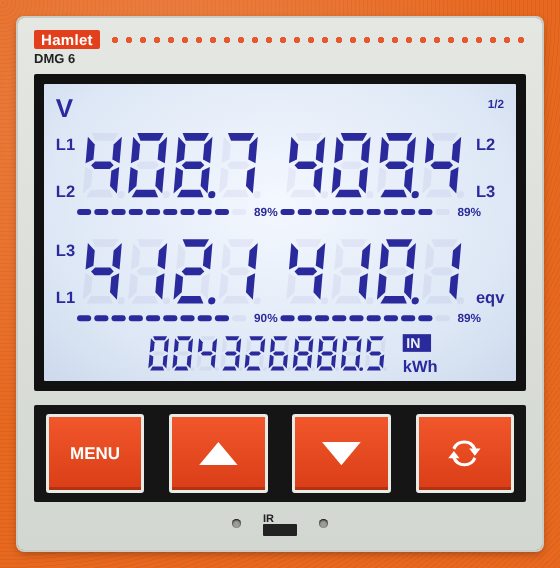

# Panel Meter Card

A Home Assistant dashboard card that looks like a 3-phase multifunction panel meter: blue LCD digits, bar graphs, a kWh counter and buttons to page through the readings.



## Install with HACS

1. HACS → ⋮ (top right) → **Custom repositories**
2. Repository: `https://github.com/wesselswynand2-prog/panel-meter-card`, Type: **Dashboard** → **Add**
3. Search HACS for **Panel Meter Card** → **Download**
4. Refresh the browser (Ctrl+F5)

HACS adds the dashboard resource for you. When a new version is released, HACS shows it under Updates.

## Buttons

| Button | Action |
|---|---|
| MENU | Open history for the first reading on the page |
| ▲ / ▼ | Previous / next page |
| ⟳ | Auto-cycle pages on/off |

Tap any number to open that sensor's history.

## Example

```yaml
type: custom:panel-meter-card
brand: Hamlet
model: DMG 6
energy: sensor.meter_energy_import
pages:
  - unit: V
    max: 460
    cells:
      - { entity: sensor.meter_voltage_l1_l2, top: L1, bottom: L2 }
      - { entity: sensor.meter_voltage_l2_l3, top: L2, bottom: L3 }
      - { entity: sensor.meter_voltage_l3_l1, top: L3, bottom: L1 }
      - { entity: sensor.meter_voltage_ll_avg, bottom: eqv }
  - unit: A
    max: 100
    cells:
      - { entity: sensor.meter_current_l1, top: L1 }
      - { entity: sensor.meter_current_l2, top: L2 }
      - { entity: sensor.meter_current_l3, top: L3 }
      - { entity: sensor.meter_current_n, top: N }
  - unit: kW
    max: 70
    decimals: 2
    cells:
      - { entity: sensor.meter_power_l1, top: L1, multiply: 0.001 }
      - { entity: sensor.meter_power_l2, top: L2, multiply: 0.001 }
      - { entity: sensor.meter_power_l3, top: L3, multiply: 0.001 }
      - { entity: sensor.meter_power_total, bottom: "Σ", multiply: 0.001 }
```

## Options

| Option | Default | Description |
|---|---|---|
| `brand` | `METER` | Text in the red badge |
| `model` | `PM 1` | Text under the badge |
| `energy` | – | kWh sensor for the bottom counter |
| `energy_label` / `energy_unit` | `IN` / `kWh` | Tag and unit next to the counter |
| `energy_digits` / `energy_decimals` | `10` / `1` | Counter size |
| `energy_multiply` | `1` | Scale the energy value |
| `auto_cycle` | `false` | Start with page cycling on |
| `cycle_seconds` | `6` | Seconds per page when cycling |
| `panel` | `true` | Orange panel background (`false` = plain card) |
| `panel_color` | `#e8681f` | Panel background colour |
| `show_ir` | `true` | Show the IR port detail |

**Per page:** `unit`, `max` (full scale for the bar graphs), `digits` (default 4), `decimals` (default 1), `cells` (up to 4).

**Per cell:** `entity`, `top`, `bottom` (labels), `max`, `digits`, `decimals`, `multiply`.
